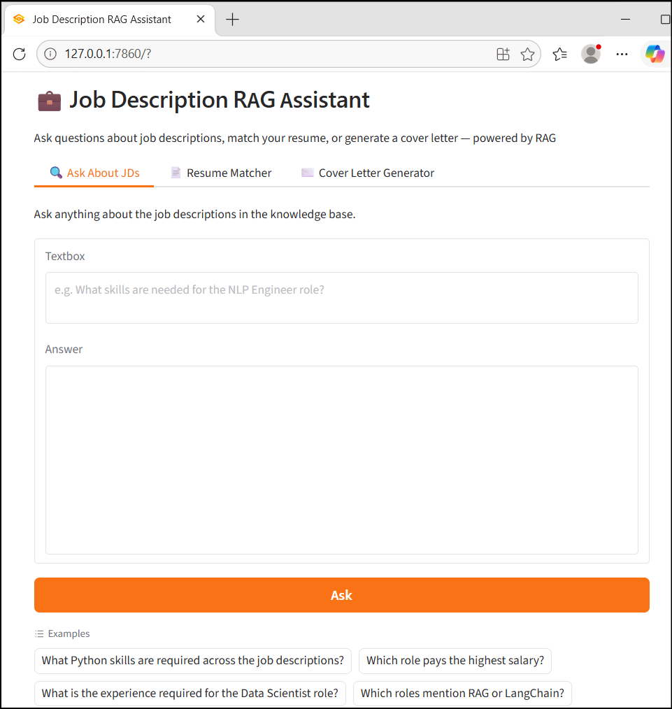

# Job Description RAG Assistant

A RAG (Retrieval-Augmented Generation) based application that helps job seekers analyze job descriptions, match resumes with jobs, answer job-related questions, and generate personalized cover letters using Groq and FAISS vector search.



---

## What it does

| Tab | Feature |
|---|---|
| 🔍 Ask About JDs | Ask natural language questions about any job description in the knowledge base |
| 📄 Resume Matcher | Paste your resume — get a match score, skill gap analysis, and improvement tips |
| ✉️ Cover Letter Generator | Auto-generate a tailored cover letter from your resume + target role |

---

## How RAG works here

```
docs/*.txt (job descriptions)
        ↓
ingest.py → chunks + embeds with all-MiniLM-L6-v2 → FAISS index
        ↓
app.py → user query → retrieve top-k chunks → send to GPT-OSS 120B → answer
```

1. Job descriptions are stored as plain `.txt` files in `docs/`.
2. `ingest.py` splits them into chunks, embeds using a free HuggingFace model, and saves a local FAISS index.
3. On every query, the app retrieves the most relevant chunks and sends them as context to the LLM.
4. LLM answers using only the retrieved context (not hallucinating from general knowledge).

---

## Project Structure

```
Job_Description_RAG/
├── docs/                       # Job description text files (knowledge base)
│   ├── jd_data_scientist.txt
│   ├── jd_ml_engineer.txt
│   └── jd_nlp_engineer.txt
├── rag/
│   └── rag_pipeline.py         # FAISS index builder and retriever
├── app.py
├── ingest.py                   # Script to build/rebuild FAISS index
├── requirements.txt
└── .env
```

---

## Setup

```bash
pip install -r requirements.txt
```

Create `.env` and add your Groq API key (free at [console.groq.com](https://console.groq.com)):
```
GROQ_API_KEY=your_key_here
```

---

## Run

**Step 1 — Build the index** (only needed once, or after adding new JDs)
```bash
python ingest.py
```

**Step 2 — Launch the app**
```bash
python app.py
```

Open `http://127.0.0.1:7860` in your browser.

---

## Add your own Job Descriptions

1. Create a `.txt` file in `docs/` with the job description text
2. Run `python ingest.py` to rebuild the index
3. Restart the app — your new JD is now searchable

---

## Tech Stack

Python, LangChain, FAISS, HuggingFace Embeddings (all-MiniLM-L6-v2), Groq (GPT-OSS 120B), Gradio